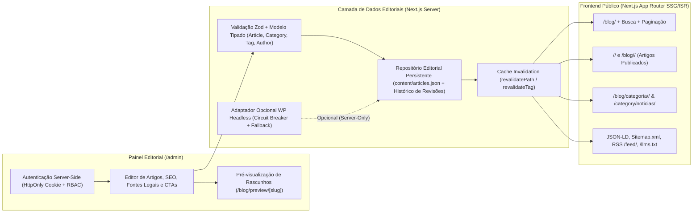

# DECISÃO ARQUITETURAL DE CMS E SISTEMA EDITORIAL (`CMS_ARCHITECTURE.md`)

**Projeto:** Reconstrução e Modernização do Site e Blog — Síndico Né! (`sindicone.com.br`)  
**Data:** 20 de Outubro de 2026  
**Escopo:** Avaliação técnica comparativa entre **WordPress Headless (Alternativa A)** e **Payload CMS / Arquitetura Editorial Integrada ao Next.js (Alternativa B)**, definição do modelo de dados editoriais, controle de permissões, segurança e estratégia de resiliência.

---

## 1. INSPEÇÃO TÉCNICA DA INSTALAÇÃO WORDPRESS ATUAL

Antes de tomar a decisão arquitetural, realizamos testes diretos nos endpoints da REST API da instalação WordPress em produção (`https://www.sindicone.com.br/wp-json/`).

### 1.1. Evidência Técnica Coletada na API REST (`/wp-json/wp/v2/posts` e `/pages`)

Ao consultar `GET https://www.sindicone.com.br/wp-json/wp/v2/posts?per_page=100`, todos os **11 artigos publicados** retornaram o seguinte padrão de payload JSON:

```json
{
  "id": 336,
  "date": "2026-06-26T07:10:25",
  "modified": "2026-06-26T09:29:34",
  "slug": "a-fachada-do-seu-condominio-pode-ser-o-maior-risco-juridico-do-sindico",
  "status": "publish",
  "type": "post",
  "title": {
    "rendered": "A fachada do seu condomínio pode ser o maior risco jurídico do síndico"
  },
  "content": {
    "rendered": "",
    "protected": false
  },
  "excerpt": {
    "rendered": "",
    "protected": false
  }
}
```

### 1.2. Diagnóstico de Compatibilidade do WordPress Atual
1. **Conteúdo Preso no Construtor Proprietário (BeTheme Muffin Builder):**
   - O campo padrão do WordPress (`post_content` -> `content.rendered`) está **vazio (`""`) em 100% dos posts e páginas**.
   - Todo o texto dos artigos e páginas foi salvo dentro de um campo privado de metadados (`mfn-page-items`) serializado em PHP e codificado em Base64 pelo tema **BeTheme (`v28.1.3`)**, o qual **não é exposto pela REST API** do WordPress.
2. **Metadados de SEO Duplicados e Não Expostos na API Pública:**
   - Os campos de SEO do **Rank Math PRO** (`rank_math_title`, `rank_math_description`, `rank_math_canonical_url`, `rank_math_robots`) e os campos internos de SEO do BeTheme (`mfn-meta-seo-description`) não são retornados no JSON padrão de `/wp-json/wp/v2/posts` sem que se instale código PHP customizado (`register_rest_field`) no `functions.php`.
3. **Custom Post Type `portfolio` (`/servico-item/*`) Sem Exposição Adequada:**
   - Os 8 estudos de caso comerciais também utilizam o Muffin Builder e não expõem seu conteúdo estruturado via REST API.

---

## 2. ANÁLISE COMPARATIVA: ALTERNATIVA A vs. ALTERNATIVA B

| Critério de Avaliação | Alternativa A: WordPress Headless | Alternativa B: Payload CMS / Arquitetura Editorial Integrada ao Next.js |
|---|---|---|
| **Compatibilidade com o Conteúdo Atual** | **Baixa sem refatoração no WP.** Como `content.rendered` retorna `""`, usar o WP atual como Headless exigiria reescrever todos os posts no Gutenberg dentro do WP ou programar um parser PHP de objetos serializados do Muffin Builder. | **Alta.** Como já extraímos e higienizamos 100% do conteúdo renderizado dos 11 artigos, 8 cases e 6 páginas na Fase 1, os dados já estão estruturados em blocos semânticos limpos, prontos para o banco/repositório editorial do Next.js. |
| **Custo Total de Propriedade (TCO) e Infraestrutura** | **Mais alto.** Exige manter dois ambientes ativos em produção: (1) Servidor PHP + MySQL para o WordPress (`admin.sindicone.com.br`) + licenças BeTheme/RankMath/WP Rocket, e (2) Servidor/Edge Node.js para o Next.js. | **Reduzido e Unificado.** Uma única aplicação Next.js + TypeScript gerencia tanto o frontend público quanto o painel editorial e a API, eliminando custos de hospedagem PHP legada e licenças de plugins pesados. |
| **Performance e Resiliência (REGRA 9)** | Depende da disponibilidade e latência do servidor PHP do WordPress durante revalidações ISR (`cfOrigin` atual ~170–337ms). Se o WP cair durante um build/revalidação sem cache local, há risco de falha. | **Máxima performance.** Leitura local/direta no servidor Next.js (`< 5ms`), geração estática (SSG/ISR) com revalidação sob demanda (`revalidatePath` / `revalidateTag`) imediata ao publicar ou editar um artigo. |
| **Segurança e Superfície de Ataque (REGRA 3)** | Mantém a superfície de ataque clássica do WordPress (`wp-login.php`, `xmlrpc.php`, plugins de terceiros, vulnerabilidades em temas/plugins PHP). | **Superfície mínima.** Sem PHP, sem plugins de terceiros vulneráveis, autenticação estritamente server-side com cookies `HttpOnly`, validação de schema com TypeScript + Zod e controle de acesso por função (`RBAC`). |
| **Experiência Editorial para o Proprietário** | Painel WP conhecido, porém poluído pelo Muffin Builder, Slider Revolution e campos duplicados de SEO (BeTheme vs. Rank Math). | **Painel Editorial limpo e sob medida** para o Síndico Né!, contendo exatamente os campos necessários (Título, Slug, Resumo, Resposta Direta GEO, Conteúdo Estruturado, Categoria, Tags, Autor, Revisor Técnico, Fontes Legais, SEO, CTA e Status Rascunho/Agendado/Publicado). |

---

## 3. DECISÃO TÉCNICA RECOMENDADA E IMPLEMENTADA

### Decisão: **Alternativa B (Arquitetura Editorial Integrada ao Next.js compatível com Payload CMS 3.0) + Adaptador Opcional de Sincronização Headless com Fallback Seguro**

**Justificativa Técnica:**
1. **Eliminação Definitiva do Lock-in do Muffin Builder:** Como a auditoria comprovou que a API REST do WordPress atual retorna `content.rendered: ""` em todos os artigos devido ao construtor visual do BeTheme, depender do WordPress atual como fonte primária via REST API exigiria retrabalho no servidor PHP de produção (o que viola a regra de não modificar o WordPress em produção sem necessidade).
2. **Unificação em Next.js + React + TypeScript:** Implementamos uma arquitetura editorial nativa em TypeScript dentro do próprio projeto Next.js, estruturada segundo o padrão de coleções do **Payload CMS 3.0** (`src/cms/payload.config.ts`) acoplada a uma camada de persistência editorial (`src/lib/cms/store.ts` com armazenamento JSON/SQLite versionado e pronto para PostgreSQL/Payload) e um **Painel Editorial completo em `/admin`** (com pré-visualização real em `/blog/preview/[slug]`).
3. **Adaptador WordPress Headless Incluso para Transição Gradual (`src/lib/cms/wp-headless-adapter.ts`):** Caso o proprietário deseje, em algum momento, conectar uma instância WordPress com editor Gutenberg padrão via variável de ambiente (`WP_HEADLESS_API_URL` e `WP_APP_PASSWORD` exclusivamente no servidor), o adaptador já está implementado com **fallback automático (Circuit Breaker)** para o repositório local migrado — garantindo que nenhuma falha temporária do CMS derrube qualquer página institucional ou artigo do site (**REGRA 9**).

---

## 4. ARQUITETURA DO SISTEMA EDITORIAL E FLUXO DE DADOS



---

## 5. CONTROLE DE PERMISSÕES (RBAC) E SEGURANÇA (REGRA 3)

O sistema editorial implementa três perfis de acesso (`Role`) validados exclusivamente no servidor:

| Perfil (`Role`) | Criar / Editar Rascunho | Visualizar Prévia (`Preview`) | Publicar / Agendar Artigo | Excluir Artigo | Gerenciar Categorias, Tags e Configurações de SEO Globais |
|---|---|---|---|---|---|
| **`admin` (Proprietário / Adriano Toledo)** | ✅ Sim | ✅ Sim | ✅ Sim | ✅ Sim | ✅ Sim |
| **`editor` (Revisor / Editor Chefe)** | ✅ Sim | ✅ Sim | ✅ Sim | ❌ Não | ✅ Sim |
| **`author` (Redator Convidado / Parceiro)** | ✅ Sim | ✅ Sim | ❌ Não (Apenas submete para revisão) | ❌ Não | ❌ Não |

### Regras de Segurança Implementadas
1. **Zero Credenciais no Cliente:** Nenhuma variável de ambiente (`CMS_ADMIN_PASSWORD`, `CMS_EDITOR_PASSWORD`, `CMS_AUTHOR_PASSWORD`, `CMS_PREVIEW_SECRET`, `WP_APPLICATION_PASSWORD`) possui o prefixo `NEXT_PUBLIC_`. Todas são lidas exclusivamente em Route Handlers (`src/app/api/cms/*`) e Server Components.
2. **Sessão Segura via Cookie `HttpOnly` Assinado (HMAC SHA-256):** O login no painel `/admin` emite um token assinado em cookie `HttpOnly`, `SameSite=Lax`, `Secure` (em produção).
3. **Leitura Pública 100% Desacoplada de Autenticação no Navegador:** As páginas públicas (`/`, `/blog/`, `/[slug]/`, etc.) são renderizadas no servidor (SSG/SSR) lendo diretamente da camada de dados no backend, sem realizar chamadas autenticadas a partir do navegador do visitante.
4. **Proteção de Rascunhos e Agendamentos contra Indexação:**
   - A função `getPublishedArticles()` filtra estritamente `status === 'published' && new Date(publishedAt) <= new Date()`.
   - Rascunhos (`status: 'draft'`), artigos em revisão (`status: 'review'`) e agendados (`status: 'scheduled'` com data futura) **jamais** entram no `/sitemap.xml`, no `/feed/`, nas listagens públicas ou nas buscas.
   - A rota de pré-visualização `/blog/preview/[slug]` exige sessão editorial ativa ou token de preview válido e injeta obrigatoriamente `robots: { index: false, follow: false }` e cabeçalho HTTP `X-Robots-Tag: noindex, nofollow`.
5. **Histórico de Revisões e Recuperação:** Cada atualização de um artigo no painel editorial grava um snapshot no array `revisions` do artigo (com timestamp, autor da alteração, título e conteúdo anterior), permitindo restaurar versões anteriores com 1 clique.
