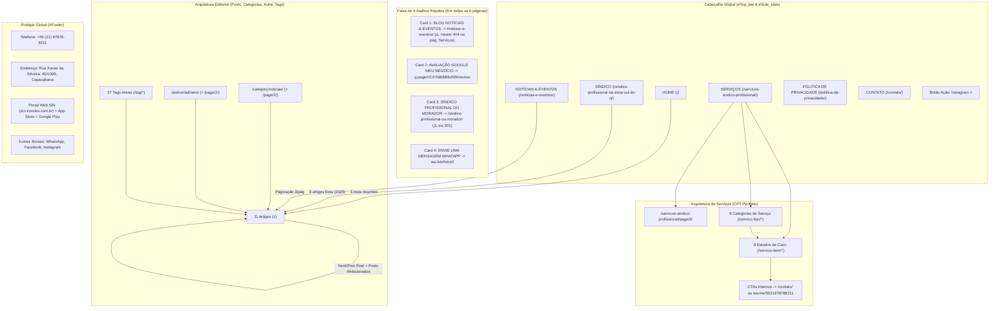

# PLANO DE MIGRAÇÃO E MODERNIZAÇÃO — SÍNDICO NÉ! (`sindicone.com.br`)

**Data da Auditoria:** 20 de Outubro de 2026  
**Domínio Auditado:** `https://www.sindicone.com.br/`  
**Escopo da Fase 1:** Auditoria Integral (URLs, Conteúdo, Design System, Arquitetura, Performance, SEO Técnico, SEO Local, GEO, Funcionalidades) e Planejamento Arquitetural para Reconstrução em Next.js + React + TypeScript.

---

## SUMÁRIO EXECUTIVO E METODOLOGIA DE AUDITORIA

Esta auditoria foi conduzida sem suposições: todas as **35 URLs canônicas listadas nos 7 sitemaps XML**, além de rotas paginadas (`/page/2/`, `/page/3/`, `/page/4/`), rotas de taxonomias de tags (`/tag/*`), endpoints da REST API do WordPress (`/wp-json/wp/v2/*`), `robots.txt` e `locations.kml` foram inspecionados e baixados integralmente.

### Stack Atual Identificada no Ambiente de Produção
- **CMS:** WordPress `7.1.3` (`pt-BR`)
- **Tema Base:** BeTheme (`betheme` v`28.1.3`) utilizando o construtor visual **Muffin Builder** sobre o template pré-construído *"CityHall"* (`cityhall-subheader*.jpg`, `cityhall-shortcuts-icon*.png`, `cityhall-home-*`).
- **Plugins e Módulos Ativos:**
  - **Slider Revolution** (`revslider` v`6.5.31`) — carrossel hero na página inicial.
  - **Contact Form 7** (`contact-form-7` v`6.1.6`) — formulário de contato (ID `6`, hash `556a01d`).
  - **Rank Math SEO PRO** — gerenciamento de sitemaps XML, `robots`, Open Graph e JSON-LD.
  - **WP Rocket** — cache de página, minificação CSS (`?ver=1778231572`), `RocketLazyLoadScripts` e substituição de imagens por placeholders SVG (`data-lazy-src`).
  - **Google Site Kit** (`v1.175.0`) + **Google Tag Manager / GA4** (`G-5JKJHM2SFL`).
- **Infraestrutura de Borda (Edge/CDN):** Cloudflare (`cf-cache-status: DYNAMIC` para HTML, `email-decode.min.js` para ofuscação de e-mail, `beacon.min.js` para Cloudflare Browser Insights).

---

## 1. INVENTÁRIO COMPLETO DE URLs PÚBLICAS

Foram mapeadas todas as URLs públicas a partir de `sitemap_index.xml`, API REST (`wp/v2/pages`, `wp/v2/posts`, `wp/v2/tags`, `wp/v2/media`) e rastreamento de links internos (incluindo paginações, redirecionamentos e links quebrados).

### 1.1. Sitemaps XML e Arquivos de Controle

| # | URL | Tipo | Status HTTP | Observações Técnicas |
|---|---|---|---|---|
| 1 | `https://www.sindicone.com.br/robots.txt` | Controle de Crawl | `200 OK` | Contém `Crawl-delay: 10`, `Disallow: /wp-admin/`, `Disallow: /cgi-bin/`. **Ausência de diretiva `Sitemap:`**. |
| 2 | `https://www.sindicone.com.br/sitemap_index.xml` | Índice de Sitemaps | `200 OK` | Gerado pelo Rank Math SEO; referencia 7 sub-sitemaps. |
| 3 | `https://www.sindicone.com.br/page-sitemap.xml` | Sitemap de Páginas | `200 OK` | 6 páginas institucionais. |
| 4 | `https://www.sindicone.com.br/post-sitemap.xml` | Sitemap de Artigos | `200 OK` | 11 artigos do blog. |
| 5 | `https://www.sindicone.com.br/portfolio-sitemap.xml` | Sitemap de Cases/Serviços | `200 OK` | 8 itens do Custom Post Type `portfolio` (`/servico-item/*`). |
| 6 | `https://www.sindicone.com.br/category-sitemap.xml` | Sitemap de Categorias | `200 OK` | 1 categoria (`/category/noticias/`). |
| 7 | `https://www.sindicone.com.br/portfolio-types-sitemap.xml` | Sitemap de Tipos de Serviço | `200 OK` | 8 taxonomias `portfolio-types` (`/servico-tipo/*`). |
| 8 | `https://www.sindicone.com.br/author-sitemap.xml` | Sitemap de Autor | `200 OK` | 1 autor (`/author/adriano/`). |
| 9 | `https://www.sindicone.com.br/local-sitemap.xml` | Sitemap Local | `200 OK` | Aponta para `/locations.kml`. |
| 10 | `https://www.sindicone.com.br/locations.kml` | Dados Geográficos KML | `200 OK` | **Bug crítico:** Tags `<address/>`, `<phoneNumber/>` e `<coordinates/>` estão vazias. |

### 1.2. Páginas Institucionais Principais (`page-sitemap.xml` — 6 URLs)

| # | URL | WP ID | Menu Principal | Status | HTML (Bytes) | Tempo (ms) | Última Modificação |
|---|---|---|---|---|---|---|---|
| 1 | `https://www.sindicone.com.br/` | `2` | `HOME` | `200` | 229.084 B | 707,1 ms | `2026-07-28` |
| 2 | `https://www.sindicone.com.br/sindico-profissional-na-zona-sul-do-rj/` | `16` | `SÍNDICO` | `200` | 213.826 B | 481,7 ms | `2026-03-20` |
| 3 | `https://www.sindicone.com.br/servicos-sindico-profissional/` | `147` | `SERVIÇOS` | `200` | 217.342 B | 734,2 ms | `2025-08-06` |
| 4 | `https://www.sindicone.com.br/noticias-e-eventos/` | `12` | `NOTÍCIAS & EVENTOS` | `200` | 213.562 B | 475,7 ms | `2026-03-19` |
| 5 | `https://www.sindicone.com.br/politica-de-privacidade/` | `3` | `POLÍTICA DE PRIVACIDADE` | `200` | 200.364 B | 442,3 ms | `2026-03-20` |
| 6 | `https://www.sindicone.com.br/contato/` | `14` | `CONTATO` | `200` | 209.193 B | 488,7 ms | `2026-03-20` |

### 1.3. Artigos do Blog (`post-sitemap.xml` — 11 URLs)

| # | URL | WP ID | Data Publicação | Status | HTML (Bytes) | Tempo (ms) | Categoria |
|---|---|---|---|---|---|---|---|
| 1 | `https://www.sindicone.com.br/a-fachada-do-seu-condominio-pode-ser-o-maior-risco-juridico-do-sindico/` | `336` | `2026-06-26` | `200` | 215.137 B | 441,8 ms | Notícias |
| 2 | `https://www.sindicone.com.br/escala-6x1-o-que-esta-em-discussao-o-que-diz-a-lei-e-o-que-ainda-pode-mudar/` | `329` | `2026-06-08` | `200` | 215.216 B | 418,5 ms | Notícias |
| 3 | `https://www.sindicone.com.br/parceria-sindico-ne-e-forneria-carioca/` | `317` | `2026-05-16` | `200` | 226.767 B | 479,6 ms | Notícias |
| 4 | `https://www.sindicone.com.br/quem-paga-o-condominio-inquilino-proprietario/` | `296` | `2026-03-20` | `200` | 218.150 B | 476,4 ms | Notícias |
| 5 | `https://www.sindicone.com.br/o-que-e-um-condominio/` | `285` | `2026-03-19` | `200` | 217.375 B | 431,4 ms | Notícias |
| 6 | `https://www.sindicone.com.br/sindico-profissional-e-por-que-contratar/` | `49` | `2025-07-20` | `200` | 208.682 B | 464,1 ms | Notícias |
| 7 | `https://www.sindicone.com.br/o-que-faz-um-sindico-profissional/` | `53` | `2025-07-19` | `200` | 210.463 B | 362,3 ms | Notícias |
| 8 | `https://www.sindicone.com.br/contratacao-de-um-sindico-profissional/` | `51` | `2025-07-04` | `200` | 208.187 B | 467,3 ms | Notícias |
| 9 | `https://www.sindicone.com.br/sindico-profissional-ou-morador/` | `57` | `2025-07-04` | `200` | 204.827 B | 415,7 ms | Notícias |
| 10 | `https://www.sindicone.com.br/carga-horaria-do-sindico-profissional/` | `55` | `2025-06-24` | `200` | 210.963 B | 441,0 ms | Notícias |
| 11 | `https://www.sindicone.com.br/quanto-ganha-um-sindico-profissional/` | `62` | `2025-05-24` | `200` | 207.437 B | 442,6 ms | Notícias |

### 1.4. Itens de Serviços / Estudos de Caso (`portfolio-sitemap.xml` — 8 URLs)

No WordPress atual, os serviços detalhados foram cadastrados usando o Custom Post Type `portfolio` do BeTheme, com slug reescrito para `/servico-item/*`. Cada página apresenta um estudo de caso real na Zona Sul (Copacabana ou Botafogo).

| # | URL | Título H1 | Taxonomia Vinculada (`/servico-tipo/*`) | Status | HTML (Bytes) | Tempo (ms) |
|---|---|---|---|---|---|---|
| 1 | `https://www.sindicone.com.br/servico-item/auditoria-de-contratos/` | Diagnóstico completo de contratos anteriores e práticas contábeis | `auditoria-de-gestao-e-contratos` | `200` | 193.300 B | 386,3 ms |
| 2 | `https://www.sindicone.com.br/servico-item/reducao-de-custos/` | Redução de custos em condomínio \| Síndico Né! | `gestao-condominial` | `200` | 194.252 B | 892,5 ms |
| 3 | `https://www.sindicone.com.br/servico-item/planejamento-orcamentario/` | Planejamento orçamentário condominial \| Síndico Né! | `planejamento-financeiro` | `200` | 193.797 B | 459,9 ms |
| 4 | `https://www.sindicone.com.br/servico-item/assembleia-condominial/` | Assembleia condominial organizada com apoio profissional \| Síndico Né! | `prestacao-de-contas-assembleias` | `200` | 194.726 B | 435,9 ms |
| 5 | `https://www.sindicone.com.br/servico-item/gestao-de-fornecedores/` | Gestão de fornecedores em condomínio \| Síndico Né! | `gestao-de-prestadores-manutencao` | `200` | 194.755 B | 444,7 ms |
| 6 | `https://www.sindicone.com.br/servico-item/apoio-tecnico-ao-conselho-fiscal/` | Apoio técnico ao conselho fiscal em decisão de manutenção | `consultoria-condominial` | `200` | 197.050 B | 439,5 ms |
| 7 | `https://www.sindicone.com.br/servico-item/transicao-de-sindico/` | Transição de síndico com apoio jurídico \| Síndico Né! | `substituicao-de-sindico` | `200` | 194.571 B | 435,2 ms |
| 8 | `https://www.sindicone.com.br/servico-item/mediacao-moradores-e-zeladoria/` | Mediação de impasse entre moradores e zeladoria | `administracao-de-conflitos` | `200` | 193.702 B | 474,3 ms |

### 1.5. Taxonomias de Tipos de Serviço (`portfolio-types-sitemap.xml` — 8 URLs)

Cada `/servico-tipo/*` funciona como arquivo de categoria de portfólio (1:1 com os 8 itens acima):

| # | URL | Título H1 | Item Listado | Status | HTML (Bytes) | Tempo (ms) |
|---|---|---|---|---|---|---|
| 1 | `https://www.sindicone.com.br/servico-tipo/gestao-condominial/` | Gestão Condominial | `reducao-de-custos` | `200` | 187.224 B | 488,1 ms |
| 2 | `https://www.sindicone.com.br/servico-tipo/substituicao-de-sindico/` | Substituição de Síndico | `transicao-de-sindico` | `200` | 187.385 B | 460,8 ms |
| 3 | `https://www.sindicone.com.br/servico-tipo/consultoria-condominial/` | Consultoria Condominial | `apoio-tecnico-ao-conselho-fiscal` | `200` | 187.400 B | 459,0 ms |
| 4 | `https://www.sindicone.com.br/servico-tipo/prestacao-de-contas-assembleias/` | Prestação de Contas & Assembleias | `assembleia-condominial` | `200` | 187.617 B | 439,9 ms |
| 5 | `https://www.sindicone.com.br/servico-tipo/gestao-de-prestadores-manutencao/` | Gestão de Prestadores & Manutenção | `gestao-de-fornecedores` | `200` | 187.588 B | 441,3 ms |
| 6 | `https://www.sindicone.com.br/servico-tipo/planejamento-financeiro/` | Planejamento Financeiro | `planejamento-orcamentario` | `200` | 187.363 B | 451,2 ms |
| 7 | `https://www.sindicone.com.br/servico-tipo/administracao-de-conflitos/` | Administração de Conflitos | `mediacao-moradores-e-zeladoria` | `200` | 187.432 B | 428,6 ms |
| 8 | `https://www.sindicone.com.br/servico-tipo/auditoria-de-gestao-e-contratos/` | Auditoria de Gestão e Contratos | `auditoria-de-contratos` | `200` | 188.014 B | 468,7 ms |

### 1.6. Arquivos de Categoria, Autor, Paginações, Feeds e Tags

| Categoria de Rota | URL(s) | Status | Detalhamento |
|---|---|---|---|
| **Categoria de Blog** | `https://www.sindicone.com.br/category/noticias/`<br>`https://www.sindicone.com.br/category/noticias/page/2/` | `200` | Lista os 11 artigos (9 na pág. 1 + 2 na pág. 2). |
| **Arquivo de Autor** | `https://www.sindicone.com.br/author/adriano/`<br>`https://www.sindicone.com.br/author/adriano/page/2/` | `200` | Autor `adriano` (ID 1); lista os mesmos 11 artigos (9 na pág. 1 + 2 na pág. 2). |
| **Paginação de Serviços** | `https://www.sindicone.com.br/servicos-sindico-profissional/page/2/` | `200` | Exibe os outros 4 itens de serviço (`planejamento-orcamentario`, `prestacao-de-contas-assembleias`, `reducao-de-custos`, `transicao-de-sindico`) acionados pelo botão "Carregar mais". |
| **Paginação de Notícias** | `https://www.sindicone.com.br/noticias-e-eventos/page/2/`<br>`https://www.sindicone.com.br/noticias-e-eventos/page/3/`<br>`https://www.sindicone.com.br/noticias-e-eventos/page/4/` | `200` | Paginação de 3 artigos por página acionada pelo botão "Carregar mais". |
| **Feeds RSS** | `https://www.sindicone.com.br/feed/`<br>`https://www.sindicone.com.br/comments/feed/` | `200` | Feeds XML padrão do WordPress. |
| **Tags do Blog (32 tags no WP)** | `/tag/clt-artigo-67/`, `/tag/como-contratar-sindico-profissional/`, `/tag/condominio-zona-sul-rj/`, `/tag/contratacao-de-sindico/`, `/tag/convivencia-em-condominio/`, `/tag/descanso-do-trabalhador/`, `/tag/descanso-semanal-remunerado/`, `/tag/despesas-condominio-inquilino/`, `/tag/despesas-condominio-proprietario/`, `/tag/direito-do-trabalho/`, `/tag/eleicao-de-sindico/`, `/tag/escala-6x1/`, `/tag/gestao-condominial/`, `/tag/gestao-condominial-rj/`, `/tag/jornada-6x1-brasil/`, `/tag/jornada-de-trabalho/`, `/tag/legislacao-trabalhista/`, `/tag/mudancas-na-clt/`, `/tag/quem-paga-condominio-inquilino/`, `/tag/quem-paga-o-condominio-inquilino-ou-proprietario/`, `/tag/quem-paga-taxa-de-condominio/`, `/tag/reforma-trabalhista-2026/`, `/tag/remuneracao-sindico/`, `/tag/sindico-para-construtora/`, `/tag/sindico-profissional/`, `/tag/beneficios-exclusivos-e-convivencia-mais-leve-nos-condominios-da-zona-sul-do-rio/`, `/tag/conheca-a-parceria-sindico-ne-e-forneria-carioca-uma-acao-que-une-pizza/`, `/tag/o-que-e-condominio-como-funciona-um-condominio-quem-e-condomino-quem-manda-no-condominio-taxa-de-condominio-sindico-profissional-gestao-de-condominio/`, `/tag/reforma-de-fachada-condominio-manutencao-predial-com-engenharia-responsabilidade-civil-sindico-obras-com-art-e-laudo-tecnico-gestao-condominial-profissional/`, `/tag/veja-passo-a-passo-como-contratar-um-sindico-profissional-avaliacao/` | `200` | 27 tags possuem `count >= 1` (5 tags órfãs possuem `count = 0`: `assembleia-de-condominio`, `codigo-civil-condominio`, `contrato-sindico-profissional`, `proposta-sindico-profissional`, `sindico-no-rio-de-janeiro`). Nota: 4 tags foram criadas acidentalmente colando listas inteiras de palavras-chave ou meta descriptions no campo de tag. |

### 1.7. URLs Internas com Erro (404) ou Redirecionamento (301) Detectadas no Site Atual

| URL Encontrada no HTML | Onde Aparece | Status Atual | Destino / Diagnóstico |
|---|---|---|---|
| `https://www.sindicone.com.br/news/` | Card 1 ("BLOG / NOTÍCIAS & EVENTOS") da página `/servicos-sindico-profissional/` | **`404 Not Found`** | Resquício do tema demo CityHall. Nas demais páginas, esse mesmo card aponta para `/noticias-e-eventos/`. |
| `https://www.sindicone.com.br/sindico-profissional-ou-morador-o-que-vale-mais-a-pena/` | Card 3 ("SÍNDICO PROFISSONAL OU MORADOR") em todas as 6 páginas principais | **`301 Moved Permanently`** | Redireciona para `/sindico-profissional-ou-morador/`. Gera um hop 301 desnecessário em cliques internos. |
| `#` (âncora vazia) | Primeiro card ("Gestão condominial profissional") da seção "O QUE VOCÊ ESTÁ PROCURANDO?" na Home | `N/A` | Link quebrado/vazio (`href="#"`). Os outros 7 itens da grade sequer possuem tag `<a>`. |

---

## 2. INVENTÁRIO DE CONTEÚDO E RECURSOS VISUAIS (DESIGN SYSTEM)

### 2.1. Tokens Visuais Extraídos do CSS de Produção

#### Paleta de Cores Oficial
| Token Semântico | Hexadecimal | Uso Exato no Site Atual |
|---|---|---|
| **Brand Primary / Lime Accent** | `#cddc39` | Botões principais, botão `Instagram >` no topo, destaques (`highlight`), marcadores de lista, ícones de serviço, bordas de foco, paginação ativa. |
| **Brand Primary Hover / Olive** | `#aab921` | Hover de botões `#cddc39` e fundo do **Card 3** da faixa de 4 atalhos rápidos (`SÍNDICO PROFISSONAL OU MORADOR`). |
| **Brand Dark / Espresso Charcoal** | `#2e2821` | Cor de texto principal (`body`, `h1`-`h6`), fundo do Rodapé (`#Footer`), fundo do **Card 4** da faixa de atalhos (`ENVIE UMA MENSAGEM WHATAPP`), texto sobre botões `#cddc39`. |
| **Header Dark Surface** | `#232323` | Cor de fundo base do `#Header_wrapper` e `#Intro`. |
| **Mobile Drawer Surface** | `#191919` | Fundo do menu lateral mobile (`#Side_slide`), texto `#a6a6a6`. |
| **Brand Secondary / Purple** | `#9C27B0` | Presente na logomarca (`logo-sindicone-verde-roxo.svg`) e aplicado como fundo da seção "LEMBRE-SE" da Home (via `elementor/css/post-2.css`). |
| **Cyan Banner Surface** | `#00BCD4` | Fundo do banner inferior da Home ("SÍNDICO NÉ! / LEMBRE-SE / Síndico Profissional Especializado..."). |
| **Warm Gold Accent** | `#ffce60` | Fundo do banner inferior da página `/contato/` ("Redução de custos em condomínio") e cor do ícone de telefone no rodapé (`<i class="icon-call" style="color:#ffce60">`). |
| **Shortcut Card 2 Gray** | `#a2a2a2` | Fundo do **Card 2** da faixa de atalhos rápidos (`AVALIAÇÃO GOOGLE MEU NEGÓCIO`). |
| **Section Light Gray 1** | `#ededed` | Fundo de seções secundárias (Home "O QUE É UM SÍNDICO PROFISSIONAL?", Home "NOTÍCIAS RECENTES", Contato "Tem alguma dúvida?"). |
| **Section Light Gray 2** | `#f5f5f5` | Fundo da seção "AUTORIDADE E CONFIANÇA" (Certificados) na Home e seção "NOTÍCIAS RECENTES" na página Síndico. |
| **Section Light Gray 3** | `#f7f7f7` | Fundo do corpo das páginas `/noticias-e-eventos/` e `/politica-de-privacidade/`. |
| **Section Medium Gray** | `#dddddd` | Fundo da grade de cases na página `/servicos-sindico-profissional/`. |
| **Body Background / White** | `#ffffff` | Fundo padrão do `#Wrapper`, `#Content`, **Card 1** da faixa de atalhos (`BLOG NOTÍCIAS & EVENTOS`) e cards de blog/serviços. |
| **Muted Text / Meta** | `#a8a8a8` | Datas de publicação, metadados de autor/categoria e breadcrumbs. |

#### Tipografia (`next/font/google`)
- **Família Primária (Corpo, Menus, Subheader):** `Barlow` (pesos `300`, `400`, `400italic`, `500`, `600`, `700`, `700italic`).
- **Família de Títulos (Headings H1–H6):** `Barlow Condensed` (pesos `400`, `500`, `600`, `700`).
- **Escala Tipográfica Desktop (`>= 1240px`):**
  - `Body`: `16px`, `line-height: 30px`, `font-weight: 400`, `letter-spacing: 0px`.
  - `Big / Lead`: `18px`, `line-height: 32px`, `font-weight: 400`.
  - `Menu Principal (#Top_bar .menu > li > a)`: `Barlow`, `16px`, `font-weight: 500`, `padding: 15px 0`, `line-height: 60px`.
  - `Subheader Title (.title)`: `Barlow`, `80px`, `line-height: 80px`, `font-weight: 700`, cor `#ffffff` (reduz proporcionalmente em viewports menores: `60px` tablet, `40px` mobile).
  - `H1`: `Barlow Condensed`, `48px`, `line-height: 50px`, `font-weight: 500`.
  - `H2`: `Barlow Condensed`, `50px`, `line-height: 60px`, `font-weight: 600`.
  - `H3`: `Barlow Condensed`, `40px`, `line-height: 50px`, `font-weight: 500`.
  - `H4`: `Barlow Condensed`, `30px`, `line-height: 34px`, `font-weight: 500`.
  - `H5`: `Barlow Condensed`, `20px`, `line-height: 30px`, `font-weight: 500`.
  - `H6`: `Barlow Condensed`, `14px`, `line-height: 25px`, `font-weight: 500`, `letter-spacing: 2px` (usado como *eyebrow/overtitle* acima dos `H2`).

#### Grid, Espaçamentos e Componentes Globais
- **Container Máximo (`.section_wrapper`, `.container`):** `max-width: 1220px` centralizado (`margin: 0 auto`), com margem interna de `1%` por coluna.
- **Breakpoints Responsivos:**
  - Desktop Full: `>= 1240px` (Menu horizontal visível).
  - Tablet Landscape / Notebook: `960px – 1239px` (Menu colapsa para hambúrguer `.responsive-menu-toggle` + drawer `#Side_slide`).
  - Tablet Portrait: `768px – 959px`.
  - Mobile: `< 768px` (Colunas empilham em `100%`, escala tipográfica reduz em ~25–40%).
- **Cabeçalho (`#Top_bar`):**
  - Posicionamento absoluto sobre o Hero/Subheader (`top: 30px`), largura fluida com `margin: 0 35px`.
  - Logomarca SVG à esquerda (`width: 350px`, `height: 60px`, `padding: 30px 0`).
  - Modo Sticky (`.is-sticky`): fixo no topo (`height: 60px`), fundo escuro com `opacity: 0.97`, logo reduzido (`max-height: 35px`).
  - Botão de ação à direita (`a.action_button`): texto `Instagram >` com ícone `icon-right-open`, fundo `#cddc39`, texto `#2e2821`, `border-radius: 50px`, `padding: 16px 35px`.
- **Faixa de 4 Atalhos Rápidos (Overlap Strip):**
  - Presente logo abaixo do Hero/Subheader nas 6 páginas principais com sobreposição negativa (`margin-top: -80px`, `z-index: 2`).
  - 4 colunas iguais (`25%` cada no desktop, sem espaçamento lateral ou com `margin: 0px 2% 0px 0px`, `padding: 45px 40px 30px`, `border-radius: 3px`):
    1. **Card 1 (Fundo `#ffffff`, Texto `#2e2821`):** Ícone `cityhall-shortcuts-icon1.png` + `BLOG / NOTÍCIAS & EVENTOS` -> Link `/noticias-e-eventos/`.
    2. **Card 2 (Fundo `#a2a2a2`, Texto `#ffffff`):** Ícone `cityhall-shortcuts-icon2.png` + `AVALIAÇÃO / GOOGLE / MEU NEGÓCIO` -> Link `https://g.page/r/Cfr7ld6BBftzEBI/review`.
    3. **Card 3 (Fundo `#aab921`, Texto `#ffffff`):** Ícone `cityhall-shortcuts-icon4.png` + `SÍNDICO PROFISSONAL / OU MORADOR` -> Link `/sindico-profissional-ou-morador/`.
    4. **Card 4 (Fundo `#2e2821`, Texto `#ffffff`):** Ícone `cityhall-shortcuts-icon4.png` + `ENVIE UMA / MENSAGEM / WHATAPP` -> Link `https://wa.link/hdxrtf`.

### 2.2. Registro Integral do Conteúdo Textual por Página

Todo o conteúdo textual das 35 páginas foi extraído e arquivado sem abreviações. Abaixo está o registro fiel de cada página e seção:

#### A. Página Inicial (`/`)
1. **Hero Slider (Slider Revolution):**
   - **Eyebrow:** `SÍNDICO PROFISSIONAL`
   - **Título Principal Visual:** `VANTAGENS, FUNÇÕES E CONTRATAÇÃO`
   - **Subtítulo:** *"Seu condomínio merece um síndico qualificado, com certificações, experiência comprovada e total transparência. Solicite uma proposta personalizada agora mesmo."*
   - **Fundo rotativo (3 imagens):** `predio_botafogo1.jpg`, `121191.jpg`, `predio_copacabana.jpg` (com efeito Ken Burns de zoom suave).
2. **Faixa de 4 Atalhos Rápidos:** `BLOG NOTÍCIAS & EVENTOS`, `AVALIAÇÃO GOOGLE MEU NEGÓCIO`, `SÍNDICO PROFISSONAL OU MORADOR`, `ENVIE UMA MENSAGEM WHATAPP`.
3. **Seção "O QUE É UM SÍNDICO PROFISSIONAL?" (Fundo `#ededed`):**
   - `H6`: `SÍNDICO PROFISSIONAL`
   - `H2`: `O QUE É UM SÍNDICO PROFISSIONAL?`
   - **Texto (2 colunas):**
     - Coluna 1: *"O síndico profissional é um especialista contratado para administrar e supervisionar todas as demandas de um condomínio, com foco em eficiência, transparência e conformidade legal. Diferente de um síndico morador, esse profissional atua de forma imparcial e técnica, aplicando seus conhecimentos em finanças, manutenção predial, legislação condominial, gestão de pessoas e mediação de conflitos."*
     - Coluna 2: *"Com experiência e formação específica, o síndico profissional é capaz de conduzir a rotina do condomínio com visão estratégica, garantindo organização, economia e tranquilidade para os moradores e para a administradora."*
4. **Seção Banner Roxo "LEMBRE-SE" (Fundo `#9C27B0` + imagem de fundo):**
   - `H6`: `SÍNDICO` | `H2`: `LEMBRE-SE`
   - `H5`: *"Que o síndico profissional não reside no condomínio, o que traz imparcialidade e foco na gestão."*
5. **Seção "NOTÍCIAS RECENTES" (Fundo `#ededed`):**
   - `H6`: `ARTIGOS` | `H2`: `NOTÍCIAS RECENTES`
   - Exibe os 3 artigos mais recentes com imagem destacada, data e link.
6. **Seção "AUTORIDADE E CONFIANÇA" (Fundo `#f5f5f5`):**
   - `H6`: `CERTIFICADOS` | `H2`: `AUTORIDADE E CONFIANÇA`
   - **6 Cards com Logos (3 por linha):**
     1. **TOKIO MARINE** (`tokio.jpg`): *"Cobertura pessoa jurídica até 1 MILHÃO de Reais"*
     2. **AKAD SEGURO** (`AKAD.jpg`): *"Cobertura pessoa física até 1 MILHÃO de Reais"*
     3. **CRA-RJ** (`CRA.jpg`): *"Administrador registrado CRA número 03-06783 - Rio de Janeiro"*
     4. **CRECI-Jurídico** (`CRECI.jpg`): *"Experiência em gestão imobiliária CRECI J - nº 12.974"*
     5. **SIN ICONDEV** (`Ativo-2@2x.png`): *"Tecnologia e inovação na gestão condominial"*
     6. **TOWNSQ** (`TOWN.jpg`): *"Curso em gestão condominial"*
7. **Seção "O QUE VOCÊ ESTÁ PROCURANDO?" (Grade de 8 Serviços em 2 Colunas):**
   - `H6`: `SERVIÇOS` | `H2`: `O QUE VOCÊ ESTÁ PROCURANDO?` | Subtítulo: *"Escolha abaixo a solução ideal para o seu condomínio."*
   - Coluna Esquerda:
     - `GESTÃO COMPLETA` — `Gestão condominial profissional` (`icon-Buffer`)
     - `ORIENTAÇÃO ESPECIALIZADA` — `Consultoria Condominial` (`icon-users`)
     - `CONTROLE FINANCEIRO` — `Planejamento e Prestação de Contas` (`icon-chart-line`)
     - `MEDIAÇÃO DE CONFLITOS` — `Conflitos e Assembleias` (`icon-comment-fa`)
   - Coluna Direita:
     - `MUDANÇA DE GESTÃO` — `Gestão condominial profissional` (`icon-Buffer`) *(Nota: No site atual o título H3 foi duplicado do primeiro item; corresponde à taxonomia "Substituição de Síndico")*
     - `MANUTENÇÃO & CONTRATOS` — `Gestão de Fornecedores` (`icon-users`)
     - `CONTROLE FINANCEIRO` — `Planejamento e Prestação de Contas` (`icon-chart-line`) *(Duplicado)*
     - `GOVERNANÇA & DIAGNÓSTICO` — `Auditoria de Gestão` (`icon-comment-fa`)
8. **Seção Banner Ciano Inferior (Fundo `#00BCD4`):**
   - `H6`: `SÍNDICO NÉ!` | `H2`: `LEMBRE-SE`
   - `H1`: `Síndico Profissional Especializado em Condomínios da Zona Sul do Rio de Janeiro`

#### B. Página Síndico (`/sindico-profissional-na-zona-sul-do-rj/`)
1. **Subheader:** `H1`: `Síndico Profissional na Zona Sul do RJ | Síndico Né!` (Fundo: `cityhall-subheader1.jpg`).
2. **Faixa de 4 Atalhos Rápidos.**
3. **Seção Institucional Adriano Toledo:**
   - **Coluna Esquerda (Imagem):** Retrato profissional de Adriano Toledo (`ChatGPT-Image-18-de-jul.-de-2025-06_59_00.png`, `1024x1536`).
   - **Coluna Direita:**
     - `H6`: `ADRIANO TOLEDO`
     - `H3`: `Vantagens de Contar com um Síndico Profissional`
     - **Texto (3 parágrafos):**
       1. *"Contar com um síndico profissional no Rio de Janeiro é a escolha certa para condomínios que buscam mais organização, economia e tranquilidade no dia a dia. Diferente da gestão amadora, o síndico profissional atua com conhecimento técnico, neutralidade e responsabilidade, assegurando o cumprimento das leis, a boa convivência entre os condôminos e a valorização do patrimônio."*
       2. *"Com uma gestão estratégica, ele garante transparência na prestação de contas, planejamento de manutenção preventiva, supervisão eficiente da equipe e resolução imparcial de conflitos. Além disso, reduz a sobrecarga emocional de moradores ou síndicos moradores, trazendo mais tempo, segurança e confiança para todos."*
       3. *"Se o seu condomínio enfrenta desafios como má administração, conflitos constantes ou gastos descontrolados, a solução pode estar na contratação de um síndico profissional — alguém preparado para cuidar de tudo com foco e profissionalismo."*
4. **Seção "O que faz um síndico profissional? Conheça suas funções essenciais" (8 Pilares em 2 Linhas de 4 Colunas):**
   - `H6`: `GESTÃO EFICIENTE` | `H2`: `O que faz um síndico profissional? Conheça suas funções essenciais`
   - **1. Administração (`Administração do Condomínio:`):** *"Administração do Condomínio com síndico profissional Copacabana: oferecemos uma gestão eficiente e estratégica para condomínios que precisam de organização, economia e redução de conflitos. Atuamos com responsabilidade, cumprindo obrigações legais, mantendo a comunicação fluida e garantindo tranquilidade para moradores e administradoras."*
   - **2. Assembleias (`Assembleias:`):** *"Organização de Assembleias com foco na gestão de condomínio RJ: cuidamos de toda a estruturação e condução das assembleias, garantindo a participação dos condôminos, clareza nos temas debatidos e atas bem elaboradas. Transformamos encontros formais em momentos de decisão eficazes, respeitando normas e fortalecendo a governança condominial."*
   - **3. Contas (`Prestação de Contas`):** *"Prestação de Contas transparente com síndico profissional Copacabana: entregamos relatórios claros e detalhados sobre todas as movimentações financeiras do condomínio. Nosso compromisso é com a confiança e o controle, oferecendo acesso facilitado a informações e promovendo total transparência entre gestão e condôminos."*
   - **4. Comunicação (`Comunicação`):** *"Comunicação clara e efetiva na gestão de condomínio RJ: mantemos os condôminos bem informados com canais abertos, respostas rápidas e atualização constante. Nossos processos evitam ruídos, fortalecem a confiança entre moradores e gestão, e promovem um ambiente harmonioso e profissional em todos os níveis de convivência."*
   - **5. Manutenção (`Manutenção Predial`):** *"Manutenção Predial com gestão eficiente e preventiva: zelamos pela estrutura do condomínio com um cronograma técnico que evita problemas, reduz custos e valoriza o patrimônio. Atuamos com fornecedores qualificados e inspeções regulares, trazendo tranquilidade e segurança para todos os moradores."*
   - **6. Gestão (`Gestão de Funcionários`):** *"Gestão de Funcionários com profissionalismo e controle: realizamos a contratação, supervisão e orientação de toda a equipe do condomínio. Com foco em produtividade e qualidade no atendimento, garantimos que cada colaborador atue com responsabilidade, alinhado aos valores e objetivos do condomínio."*
   - **7. Mediação (`Mediação de Conflitos`):** *"Mediação de Conflitos com imparcialidade e inteligência emocional: atuamos como facilitadores em situações delicadas, ouvindo todas as partes e propondo soluções justas. Nosso objetivo é manter a convivência saudável e prevenir desgastes entre condôminos, criando um ambiente mais leve e colaborativo."*
   - **8. Obrigações (`Obrigações Legais e Fiscais`):** *"Cumprimento das Obrigações Legais e Fiscais com precisão: asseguramos que seu condomínio esteja em dia com todas as exigências jurídicas e tributárias. Desde documentos obrigatórios até prazos e certidões, nossa gestão evita riscos, multas e garante segurança jurídica para síndicos, moradores e administradoras."*
5. **Seção "NOTÍCIAS RECENTES" (Fundo `#f5f5f5`):** Exibe 3 artigos de destaque sobre carreira/contratação (`Quanto Ganha...`, `Carga Horária...`, `Como Funciona a Contratação...`).

#### C. Página Serviços (`/servicos-sindico-profissional/`)
1. **Subheader:** `H1`: `Serviços` (Fundo: `cityhall-subheader2.jpg`).
2. **Faixa de 4 Atalhos Rápidos.**
3. **Seção "Como funciona o atendimento da Síndico Né!" (4 Etapas Numeradas + Destaque Estatístico):**
   - `H2`: `Como funciona o atendimento da Síndico Né!`
   - **Etapa `1` — Diagnóstico gratuito inicial:** *"Avaliamos o cenário atual do condomínio, contratos e principais necessidades."*
   - **Etapa `2` — Proposta personalizada:** *"Elaboramos um plano de atuação sob medida, com cronograma e previsões realistas."*
   - **Etapa `3` — Implementação com acompanhamento:** *"Iniciamos o serviço com supervisão direta e comunicação constante com o conselho."*
   - **Etapa `4` — Gestão transparente e relatórios mensais:** *"Prestação de contas digital, organização de assembleias e indicadores de desempenho."*
   - **Destaque Central:** *"Sabia que 83% dos problemas em condomínios vêm da má gestão financeira? A Síndico Né! ajuda a reverter esse cenário desde o primeiro mês."*
4. **Grade de Serviços / Cases (`portfolio_wrapper` em fundo `#dddddd`):**
   - Lista os 8 itens de serviço (`/servico-item/*`) com filtro/paginação ("Carregar mais"), exibindo imagem de capa, categoria (`/servico-tipo/*`), título `H4` e link direto `solicite contato via whatsapp` (`https://wa.me/5521978788211`).

#### D. Página Notícias & Eventos (`/noticias-e-eventos/`)
1. **Subheader:** `H1`: `NOTÍCIAS & EVENTOS` (Fundo: `cityhall-subheader4.jpg`).
2. **Faixa de 4 Atalhos Rápidos.**
3. **Listagem de Artigos (Layout `masonry tiles` / 3 colunas):** Exibe os artigos em blocos de 3 por página com imagem, categoria `Notícias`, data, título `H4`, link `Saiba mais` e botão `Carregar mais` (paginando até `/page/4/`).

#### E. Página Política de Privacidade (`/politica-de-privacidade/`)
1. **Subheader:** `H1`: `Política de Privacidade` (Fundo: `cityhall-subheader4.jpg`).
2. **Faixa de 4 Atalhos Rápidos.**
3. **Conteúdo Legal (Seções H2):**
   - `Introdução`: *"Bem-vindo à nossa Política de Privacidade! Nesta página, explicamos como coletamos, usamos e protegemos suas informações pessoais. É importante que você leia atentamente esta política para entender como tratamos seus dados."*
   - `Coleta de Informações`: **Informações Pessoais** (*"Coletamos informações como nome, endereço de e-mail, número de telefone e outras informações que você nos fornece voluntariamente."*) e **Dados de Navegação** (*"Podemos coletar informações sobre como você interage com nosso site, como endereço IP, tipo de navegador, páginas visitadas e tempo gasto em cada página."*).
   - `Uso das Informações`: **Fornecimento de Serviços** e **Melhoria do Site**.
   - `Compartilhamento de Dados`: **Parceiros de Negócios** e **Requisitos Legais**.
   - `Segurança`: *"Tomamos medidas para proteger suas informações pessoais contra acesso não autorizado, uso indevido ou divulgação."*
   - `Seus Direitos`: *"Você tem o direito de acessar, corrigir ou excluir suas informações pessoais. Entre em contato conosco se precisar de assistência."*
   - `Contato`: *"Se tiver alguma dúvida sobre nossa Política de Privacidade, entre em contato conosco através do e-mail: contato@sindicone.com.br."*

#### F. Página Contato (`/contato/`)
1. **Subheader:** `H1`: `CONTATO` (Fundo: `cityhall-subheader3.jpg`).
2. **Faixa de 4 Atalhos Rápidos.**
3. **Bloco de Informações de Contato + Google Maps:**
   - **Coluna Esquerda (Dados):**
     - `NOSSO ENDEREÇO`: `Rua Xavier da Silveira, 45/1009 Copacabana, Rio de Janeiro, 22061-010`
     - `CONTATO`: Telefone `+55(21) 97878-8211` | E-mail `contato@sindicone.com.br`
     - `HORÁRIO DE FUNCIONAMENTO`: `Segunda - Sexta: 09:00 - 18:00` | `Sábado: 09:00 - 14:00`
   - **Coluna Direita (Mapa Interativo):** Google Maps centrado em `lat: -22.9765877, lng: -43.1906181`, zoom `15`, `mapTypeId: ROADMAP`, pino customizado `cityhall-contact-pin.png`.
4. **Seção Formulário ("Tem alguma dúvida? Escreva para nós!" — Fundo `#ededed`):**
   - Formulário Contact Form 7 (veja Seção 6.1).
5. **Banner Amarelo Inferior (Fundo `#ffce60`):**
   - `H6`: `SÍNDICO NÉ!`
   - `H2`: `Redução de custos em condomínio | Síndico Né!` (com link para `/servico-item/reducao-de-custos/`)
   - Texto: *"Reduzimos até 20% das despesas fixas com renegociação contratual e gestão profissional em condomínio na Zona Sul."*

#### G. Conteúdo Integral dos 8 Estudos de Caso (`/servico-item/*`) e 11 Artigos do Blog
Todos os textos completos dos 8 estudos de caso e dos 11 artigos do blog foram integralmente extraídos no arquivo de auditoria bruta (`all_pages_content_dump.md`) e serão migrados **palavra por palavra** para a camada de conteúdo tipada do projeto Next.js, preservando títulos, subtítulos, tabelas comparativas (`Síndico Morador vs. Síndico Profissional`, `O Que Impacta no Valor`), listas de verificação, comentários do autor (*Adriano Toledo*) e referências legais (*Código Civil Lei nº 10.406/2002*, *Lei do Inquilinato Lei nº 8.245/1991*, *Lei nº 4.591/1964*, *CLT Art. 67 Decreto-Lei nº 5.452/1943*, *Lei nº 605/1949*, *ABRASSP*, *Secovi Rio*).

### 2.3. Inventário Completo de Recursos Visuais (Imagens, Vetores e Ícones)

Foram catalogados todos os ativos públicos em `/wp-content/uploads/`:

| Categoria | Arquivo / URL Relativa em `/wp-content/uploads/` | Dimensões | Formato | Uso no Site |
|---|---|---|---|---|
| **Identidade Visual** | `2025/07/logo-sindicone-verde-roxo.svg` | Vetorial (`350x60`) | SVG | Logomarca oficial no Header (desktop, sticky, mobile) e Avatar de Autor. |
| **Identidade Visual** | `2025/07/Ativo-10.png` | `155x155` | PNG | Favicon (`icon` 32x32, 192x192 e `apple-touch-icon`). |
| **Identidade Visual** | `2025/07/Ativo-14.svg` | `512x512` | SVG | Logo referenciado no Schema JSON-LD `Organization`. |
| **Hero Slider (Home)** | `2025/07/predio_botafogo1.jpg` | `1200x500` | JPEG | Slide 1 do Hero da Home. |
| **Hero Slider / Case** | `2025/07/121191.jpg` | `667x1000` | JPEG | Slide 2 do Hero da Home + Case `assembleia-condominial`. |
| **Hero Slider (Home)** | `2025/07/predio_copacabana.jpg` | `1920x800` | JPEG | Slide 3 do Hero da Home. |
| **Subheaders** | `2019/10/cityhall-subheader1.jpg` | `1920x700` | JPEG | Fundo do Subheader da página `/sindico-profissional-na-zona-sul-do-rj/`. |
| **Subheaders** | `2019/10/cityhall-subheader2.jpg` | `1920x700` | JPEG | Fundo do Subheader da página `/servicos-sindico-profissional/`. |
| **Subheaders** | `2019/10/cityhall-subheader3.jpg` | `1920x700` | JPEG | Fundo do Subheader da página `/contato/`. |
| **Subheaders** | `2019/10/cityhall-subheader4.jpg` | `1920x700` | JPEG | Fundo do Subheader de `/noticias-e-eventos/` e `/politica-de-privacidade/`. |
| **Banners Home** | `2019/10/cityhall-home-bg1.jpg` / `bg2.jpg` | `1920x800` | JPEG | Texturas de fundo das seções "LEMBRE-SE" da Home. |
| **Ícones de Atalhos** | `2019/10/cityhall-shortcuts-icon1.png`<br>`2019/10/cityhall-shortcuts-icon2.png`<br>`2019/10/cityhall-shortcuts-icon4.png` | `38x32`<br>`38x32`<br>`33x32` | PNG | Ícones dos 4 cards da faixa de atalhos rápidos. |
| **Pino do Mapa** | `2019/10/cityhall-contact-pin.png` | `50x50` | PNG | Marcador customizado no Google Maps da página `/contato/`. |
| **Foto Institucional** | `2025/07/ChatGPT-Image-18-de-jul.-de-2025-06_59_00.png` | `1024x1536` | PNG | Foto institucional de Adriano Toledo na página `/sindico-profissional-na-zona-sul-do-rj/`. |
| **Certificados / Selos** | `2026/07/tokio.jpg`<br>`2025/07/AKAD.jpg`<br>`2025/07/CRA.jpg`<br>`2025/07/CRECI.jpg`<br>`2026/07/Ativo-2@2x.png`<br>`2025/07/TOWN.jpg` | `900x900`<br>`300x300`<br>`300x300`<br>`300x300`<br>`1043x1043`<br>`300x300` | JPEG / PNG | Seção "AUTORIDADE E CONFIANÇA" na Home (Tokio Marine, Akad Seguro, CRA-RJ, CRECI-J, SIN Icondev, TownSq). |
| **Rodapé (App SIN)** | `2026/07/only-Logo-SIN-Full-NOVA.png`<br>`2026/07/disponivel-na-app-store-botao-scaled-e1785252591642.png`<br>`2026/07/googleplay-e1785252567698.png` | `400x225`<br>`535x158`<br>`535x163` | PNG | Coluna 3 do Rodapé ("Acesso via site" + botões App Store e Google Play). |
| **Cases (`/servico-item/*`)** | `2025/07/2151953950.jpg` (`auditoria-de-contratos`)<br>`2025/07/2166.jpg` (`reducao-de-custos`)<br>`2025/07/2151957111.jpg` (`planejamento-orcamentario`)<br>`2025/07/121191.jpg` (`assembleia-condominial`)<br>`2025/07/662.jpg` (`gestao-de-fornecedores`)<br>`2025/07/2150440960.jpg` e `2147842995.jpg` (`apoio-tecnico-ao-conselho-fiscal`)<br>`2025/07/3881.jpg` (`transicao-de-sindico`)<br>`2025/07/20242.jpg` (`mediacao-moradores-e-zeladoria`) | `667x1000` a `1000x1000` | JPEG | Imagens principais e de galeria dos 8 estudos de caso. |
| **Artigos do Blog** | `2026/06/7566.jpg`, `147.jpg`, `21421.jpg` (`post_fachada`)<br>`2026/06/escala-6x.webp` (`post_escala_6x1`)<br>`2026/05/Captura-de-tela-de-2026-05-16-06-43-33.png` + 6 capturas (`post_parceria_forneria`)<br>`2026/03/mini-house-stack-coins-with-green-blur-scaled-e1773999796910.jpg` + `rmb-coins-stacked...jpg` (`post_quem_paga`)<br>`2026/03/framing-landscape-while-traveling-scaled-e1773914521806.jpg` (`post_o_que_e_condominio`)<br>`2025/07/sindico-profissional.jpg` (`post_por_que_contratar`)<br>`2025/07/aproxime-se-de-uma-pessoa-sorridente-na-sala-de-conferencias.webp`, `Sindico_Profissional.webp`, `Sindico_Profissional_reuniao.webp` (`post_o_que_faz`)<br>`2025/07/1743.jpg`, `contrato-sindico.webp` (`post_contratacao`)<br>`2026/03/29440.jpg` (`post_profissional_ou_morador`)<br>`2025/06/29310.jpg`, `horario-sindico.webp`, `carga-horaria-sindico.webp` (`post_carga_horaria`)<br>`2019/10/cityhall-blog-pic1.jpg`, `dinheiro-sindico.webp`, `sindico-dinheiro.webp` (`post_quanto_ganha`) | `680x853` a `2000x2000` | JPEG / WebP / PNG | Imagens destacadas (`og:image` / hero do post) e imagens internas do corpo dos 11 artigos. |

---

## 3. MAPA DA ARQUITETURA ATUAL E RELAÇÕES DE LINKS INTERNOS



### Análise do Grafo de Links Internos
1. **Concentração de Autoridade (Hubs):** As 6 páginas do menu principal e o artigo `/sindico-profissional-ou-morador/` recebem links de todas as páginas principais (devido ao menu e à faixa de 4 atalhos).
2. **Isolamento dos Cases (`/servico-item/*`):** A grade de 8 serviços na Home ("O QUE VOCÊ ESTÁ PROCURANDO?") **não possui links funcionais** para `/servico-item/*` nem para `/servico-tipo/*`. Além disso, na página `/servicos-sindico-profissional/`, apenas 4 dos 8 cases aparecem no carregamento inicial (os outros 4 ficam escondidos na `/page/2/` atrás do botão "Carregar mais").
3. **Links de Conversão nos Artigos e Cases:** Todos os artigos e cases possuem botões de CTA no final (`Solicitar Proposta`, `Solicitar Proposta Gratuita`, `Solicitar Auditoria de Gestão`, etc.) que apontam para `/contato/` ou diretamente para o WhatsApp (`https://wa.me/5521978788211`).

---

## 4. IDENTIFICAÇÃO DE PROBLEMAS DE PERFORMANCE E CORE WEB VITALS

A análise técnica do HTML, árvore de recursos e cabeçalhos de rede revelou **7 gargalos severos** na arquitetura WordPress atual:

1. **HTML Inicial Inflado (~200 KB a 229 KB por documento):**
   - Cada página carrega cerca de **115 KB de CSS e configurações JS inline** injetadas pelo WP Rocket (`rocket-lazyload-inline-css`), BeTheme (`mfn-dynamic-inline-css`), Slider Revolution e WordPress Global Styles (`global-styles-inline-css`, `wp-block-library`).
2. **Sobrecarga do Slider Revolution (`revslider`) para um Efeito Trivial:**
   - Na Home, o site carrega `rs6.css`, `rbtools.min.js` e `rs6.min.js` (~350 KB de JavaScript minificado) apenas para exibir um texto estático sobre 3 fotos com transição de fade e leve zoom (Ken Burns).
   - O `revslider` oculta o hero inicialmente (`visibility: hidden`) até que o JavaScript seja baixado, parseado e executado no cliente, **penalizando diretamente o LCP (Largest Contentful Paint)**.
3. **Anti-Padrão de Lazy-Load no Elemento LCP:**
   - O WP Rocket substitui **todas** as imagens (inclusive a logomarca no topo, os ícones da primeira dobra e a imagem principal dos artigos/cases) por um SVG vazio (`data:image/svg+xml,...`) e depende da execução de `RocketLazyLoadScripts` após interação ou carregamento de JS para trocar `data-lazy-src` por `src`. Além disso, renderiza tags `<noscript></noscript>` duplicadas para cada imagem (fazendo o DOM ter 2x mais nós ``).
4. **Bibliotecas JavaScript Legadas e Desnecessárias em Todas as Páginas:**
   - `jquery.min.js` (`v3.7.1`) + `jquery-migrate.min.js` (`v3.4.1`)
   - `jquery-ui` (`core`, `tabs`, `accordion`, `mouse`, `sortable`)
   - **`jquery.jplayer.min.js`** (reprodutor de áudio/vídeo legado do BeTheme carregado em 100% das páginas, embora o site não possua nenhum arquivo de áudio ou vídeo!).
   - `jquery.plugins.js` (Isotope, MagnificPopup, NiceScroll, Waypoints, DebouncedResize).
   - **Impacto no INP (Interaction to Next Paint) e TBT (Total Blocking Time):** Hidratação e listeners de scroll/resize em jQuery na thread principal.
5. **14 Folhas de Estilo Externas Render-Blocking:**
   - Mesmo com minificação parcial do WP Rocket, o navegador precisa processar `wp-SinglePost-style.min.css`, `contact-form-7/styles.css`, `rs6.css`, `mfn-be.css`, `animations.min.css`, `font-awesome.min.css`, `jplayer.blue.monday.css`, `responsive.css`, `post-2.css` e Google Fonts CSS.
6. **Cache Dinâmico na Borda (`cf-cache-status: DYNAMIC`, `Cache-Control: max-age=0`):**
   - Os cabeçalhos HTTP mostram que o Cloudflare não está servindo o HTML em cache de borda (`cfOrigin;dur=170ms` a `337ms`, TTFB total entre `415ms` e `892ms`). Com Next.js Static Site Generation (SSG/ISR), o TTFB cairá para `< 30ms` direto da CDN.
7. **Imagens Não Otimizadas e Sem Dimensionamento Responsivo Adequado:**
   - Exemplo: `ChatGPT-Image-18-de-jul.-de-2025-06_59_00.png` é um arquivo PNG de `1024x1536` pesado; `Ativo-2@2x.png` (`1043x1043`) é servido para exibir um selo de `150x150px` na seção de certificados.

---

## 5. AUDITORIA PRELIMINAR DE SEO TÉCNICO, SEO LOCAL E GEO (IA)

### 5.1. Problemas Críticos de SEO Técnico Encontrados

1. **Duplicidade de `<meta name="description">` em Quase Todas as Páginas:**
   - O BeTheme possui seu próprio campo nativo de SEO que injeta uma `<meta name="description">` no `<head>`, e o plugin **Rank Math SEO PRO** injeta uma **segunda** `<meta name="description">` logo abaixo.
   - **Pior caso:** Na página `/servicos-sindico-profissional/` e em todas as 8 páginas `/servico-tipo/*`, a meta description configurada é uma lista de palavras-chave soltas: `"valorização de imóvel, síndico profissional valoriza prédio, gestão condominial e venda de imóvel, condomínio bem cuidado vende mais"`.
   - Na página `/contato/`, a primeira meta description é uma frase truncada: `"para saber mais, ou entrar em contato"`.
2. **Hierarquia de Headings (`H1`–`H6`) Quebrada ou Invertida:**
   - **Na Home (`/`):** O único `<h1>` da página (*"Síndico Profissional Especializado em Condomínios da Zona Sul do Rio de Janeiro"*) está no **último banner antes do rodapé**, enquanto o título principal na primeira dobra está dentro de uma tag customizada `<rs-layer>` sem valor semântico de título.
   - **Nos Artigos do Blog:** Páginas como `/a-fachada-do-seu-condominio.../`, `/parceria-sindico-ne-e-forneria-carioca/`, `/quem-paga-o-condominio.../`, `/o-que-e-um-condominio/` e `/contratacao-de-um-sindico-profissional/` possuem **dois `<h1>`** (um no `#Subheader` e outro no corpo do post).
   - **Na Página Serviços (`/servicos-sindico-profissional/`):** Os números `1`, `2`, `3`, `4` das etapas de atendimento estão marcados como `<h2>`, enquanto os títulos reais das etapas são apenas `<p><strong>`.
   - **Na Página Síndico (`/sindico-profissional-na-zona-sul-do-rj/`):** Os 8 cards `icon_box` concatenam a palavra do ícone ao título dentro do `<h3>` caso o estilo não separe visualmente (ex.: `<h3>AdministraçãoAdministração do Condomínio:</h3>`).
3. **Links Internos Quebrados e Redirecionamentos Internos:**
   - Link `404` para `/news/` na página de Serviços.
   - Link `301` para `/sindico-profissional-ou-morador-o-que-vale-mais-a-pena/` no Card 3 de todas as páginas principais.
   - Grade de 8 serviços na Home sem links clicáveis.
4. **Canibalização de Palavras-Chave no Blog:**
   - Existem dois artigos publicados com 1 dia de diferença (19/07/2025 e 20/07/2025) com títulos quase idênticos:
     - `/o-que-faz-um-sindico-profissional/` — *"O Que Faz um Síndico Profissional e Por Que Contratar Um?"* (focado nas atribuições e funções).
     - `/sindico-profissional-e-por-que-contratar/` — *"O Que Faz um Síndico Profissional e Por Que Contratar? Entenda Agora"* (apesar do título igual ao anterior, o texto interno é quase idêntico ao artigo `/contratacao-de-um-sindico-profissional/`, abordando o passo a passo da contratação!).
   - **Estratégia:** Ambos os URLs serão preservados com status `200` (regra de preservação de URLs), mas terão seus `<title>`, `<h1>` e metadados diferenciados semanticamente (e/ou canonicalização estratégica caso desejado pelo proprietário) para eliminar a competição direta no Google.
5. **Arquivo `robots.txt` Restritivo e Incompleto:**
   - Define `Crawl-delay: 10` (desnecessário em infraestrutura moderna e ignorado/desencorajado pelo Googlebot, mas que desacelera crawlers de IA e Bingbot) e omite `Sitemap: https://www.sindicone.com.br/sitemap_index.xml`.
6. **Atributos `alt` Ausentes na Maioria das Imagens:**
   - Mais de 75% das tags `` (incluindo fotos de estudos de caso, miniaturas de blog, ícones e botões de lojas de aplicativos) possuem `alt=""` vazio.
7. **Strings Não Traduzidas do Tema (Inglês misturado ao Português):**
   - Nas páginas `/category/noticias/`, `/author/adriano/` e cabeçalhos de posts aparecem `"Categories"`, `"Tags"`, `"Do you like it?"`, `"Read more"`, `"Enter your search"`.
8. **Pequenos Erros de Digitação no Conteúdo Atual (Documentados para Correção Cuidadosa):**
   - `"SÍNDICO PROFISSONAL"` (falta o `"I"`) e `"WHATAPP"` (falta o `"S"`) nos 4 blocos de atalho rápido.
   - `"Seunda - Sexta"` (falta o `"g"`) no rodapé global.
   - `"eu condomínio tem contratos vencidos..."` (falta o `"S"` inicial em *"Seu"*) e botão `"Fale com um Especialista]"` (colchete extra `]`) em `/servico-item/gestao-de-fornecedores/`.
   - Título SEO de `/escala-6x1.../` configurado como lista de tags: `"escala 6x1, jornada de trabalho, reforma trabalhista 2026, descanso semanal remunerado, CLT art 67"`.
   - Título SEO de `/quanto-ganha-um-sindico-profissional/` configurado genericamente como `"Gestão de Condomínios - RJ - Síndico Né! | (21) 97878-8211"`, perdendo o termo de busca principal no `<title>`.

### 5.2. Auditoria de SEO Local (`Zona Sul - RJ`)
- **Situação Atual:**
  - O arquivo `/locations.kml` gerado pelo Rank Math está **totalmente vazio** (`<address></address>`, `<phoneNumber></phoneNumber>`, `<coordinates></coordinates>`).
  - O JSON-LD atual utiliza apenas `@type: "Organization"` genérico, sem declarar endereço físico, coordenadas geográficas, telefone, horário de atendimento, faixa de preço ou bairros atendidos.
- **Otimização Planejada no Next.js:**
  - Implementar JSON-LD rico do tipo `ProfessionalService` e `LocalBusiness` (subtipo de `RealEstateAgent` / `LegalService` / `ProfessionalService`) contendo:
    - **Nome Oficial:** `Síndico Né! — Gestão Condominial e Síndico Profissional`
    - **Razão Social / Mantenedora:** `Ícone-Rio Ltda`
    - **Responsável Técnico (`founder` / `employee`):** `Adriano Toledo` (Administrador CRA-RJ nº `03-06783`, CRECI-J nº `12.974`).
    - **Endereço (`PostalAddress`):** `Rua Xavier da Silveira, 45, Sala 1009, Copacabana, Rio de Janeiro - RJ, CEP 22061-010, Brasil`.
    - **Coordenadas (`GeoCoordinates`):** `latitude: -22.9765877`, `longitude: -43.1906181`.
    - **Telefone:** `+55-21-97878-8211` | **E-mail:** `contato@sindicone.com.br`.
    - **Horário de Funcionamento (`OpeningHoursSpecification`):** Segunda a Sexta `09:00-18:00`, Sábado `09:00-14:00`.
    - **Área de Cobertura (`areaServed`):** Copacabana, Botafogo, Ipanema, Flamengo, Jardim Botânico, Leme, Leblon, Humaitá, Laranjeiras, Catete, Glória, Gávea (Zona Sul do Rio de Janeiro).
    - **Credenciais e Seguros (`hasCredential` / `makesOffer`):** Seguro Responsabilidade Civil PJ Tokio Marine (R$ 1 milhão) + PF Akad Seguro (R$ 1 milhão) = R$ 2 milhões de cobertura total.
  - Corrigir o endpoint `/locations.kml` para retornar o XML KML válido com as coordenadas e endereço completos de Copacabana.

### 5.3. Estratégia de GEO (Generative Engine Optimization — Busca com IA)
Para posicionar a **Síndico Né!** como a principal fonte citada por **Google AI Overviews (SGE), ChatGPT Search, Perplexity, Claude e Gemini** quando usuários pesquisarem por *"síndico profissional Zona Sul RJ"*, *"quanto custa síndico profissional no Rio de Janeiro"*, *"síndico profissional Copacabana"* ou *"quem paga condomínio inquilino ou proprietário"*:

1. **Implementação de `/llms.txt` e `/llms-full.txt`:**
   - Criar na raiz do projeto o padrão aberto `/llms.txt` contendo o resumo estruturado em Markdown da empresa, credenciais verificáveis (CRA-RJ `03-06783`, CRECI-J `12.974`, apólices Tokio Marine e Akad de R$ 2 milhões), endereço em Copacabana, serviços oferecidos, estudos de caso com métricas reais (ex.: *redução de 20% nas despesas fixas em Copacabana*, *redução de 80% nas reclamações internas em 1 trimestre*, *remuneração média no RJ entre R$ 2.000 e R$ 8.000/mês e carga horária de 12h a 32h mensais*) e links canônicos para todas as páginas.
2. **Dados Estruturados Semânticos Avançados (Schema.org JSON-LD por Página):**
   - **Home e Página Síndico:** `ProfessionalService` + `LocalBusiness` + `Person` (Adriano Toledo com `hasCredential` CRA-RJ e CRECI-J) + `FAQPage` + `BreadcrumbList`.
   - **Páginas de Serviços (`/servico-item/*`):** `Service` + `Article` (Case Study) + `BreadcrumbList`.
   - **Artigos do Blog:** `BlogPosting` / `Article` com `author` (`Person`: Adriano Toledo), `citation` (referenciando as leis oficiais citadas no texto: Lei 10.406/2002, Lei 8.245/1991, CLT Art. 67), `datePublished`, `dateModified` e `FAQPage` extraído das perguntas reais do texto.
3. **HTML Semântico Nativo para Extração por LLMs:**
   - Substituir tabelas simuladas ou texto corrido nos artigos (`/sindico-profissional-ou-morador/` e `/quanto-ganha-um-sindico-profissional/`) por tags `<table>`, `<thead>`, `<tbody>`, `<dl>`, `<dt>`, `<dd>`, `<article>`, `<section>` e `<aside>` perfeitamente estruturadas, facilitando a citação direta em respostas geradas por IA.
4. **Permissão Explícita para Bots de IA no `robots.txt`:**
   - Permitir explicitamente `GPTBot`, `OAI-SearchBot`, `ChatGPT-User`, `PerplexityBot`, `ClaudeBot`, `Google-Extended` e `Applebot-Extended`, sem `Crawl-delay: 10`.

---

## 6. FUNCIONALIDADES, FORMULÁRIOS E INTEGRAÇÕES A PRESERVAR

Todas as funcionalidades e pontos de conversão existentes foram mapeados e serão integralmente preservados:

### 6.1. Formulário de Contato (`/contato/`)
- **Estrutura Atual (Contact Form 7 — Form ID `6`):**
  - Campo 1: `your-name` (`text`, obrigatório, placeholder `"Seu nome"`)
  - Campo 2: `your-email` (`email`, obrigatório, placeholder `"Seu e-mail"`)
  - Campo 3: `your-subject` (`text`, opcional, placeholder `"Assunto"`)
  - Campo 4: `your-message` (`textarea`, 40x6, opcional, placeholder `"Sua mensagem"`)
  - Botão de Envio: `"Enviar uma mensagem"`
- **Implementação Moderna em Next.js:**
  - Componente React acessível (`<label>` associado ou `aria-label` + placeholders idênticos ao original), validação client-side e server-side com **Zod**, proteção anti-spam (Honeypot invisível + Rate Limiting por IP + suporte opcional a Cloudflare Turnstile) e **Next.js Server Action / Route Handler (`POST /api/contact`)** com envio via SMTP/Resend para `contato@sindicone.com.br` e feedback visual imediato de sucesso/erro.

### 6.2. Mapa Interativo Google Maps (`/contato/`)
- Preservação exata das coordenadas (`lat: -22.9765877, lng: -43.1906181` — Rua Xavier da Silveira, 45/1009, Copacabana) com carregamento otimizado (iframe Google Maps Embed / API com pino customizado e botão de rota direta no Google Maps) sem bloquear a thread principal no carregamento inicial.

### 6.3. Ecossistema do Portal do Condômino (SIN Icondev) no Rodapé
- Preservação integral da Coluna 3 do rodapé:
  - Logo `only-Logo-SIN-Full-NOVA.png` + link `"Clique para Acessar via web o site"` apontando para `https://sin.icondev.com.br/#/login` (`target="_blank" rel="noopener noreferrer"`).
  - Botão **App Store** apontando para `https://apps.apple.com/br/app/sin/id6448078375`.
  - Botão **Google Play** apontando para `https://play.google.com/store/apps/details?id=com.icondev.sinplus`.

### 6.4. Canais de Conversão, Redes Sociais e Avaliações
- **WhatsApp Direto:**
  - `https://wa.me/5521978788211` (presente no rodapé, no menu mobile `#Side_slide`, nos cards da página `/servicos-sindico-profissional/` e nos botões de CTA dos cases/artigos).
  - `https://wa.link/hdxrtf` (presente no Card 4 da faixa de atalhos rápidos).
- **Avaliação Google Meu Negócio:**
  - `https://g.page/r/Cfr7ld6BBftzEBI/review` (presente no Card 2 da faixa de atalhos rápidos).
- **Redes Sociais:**
  - Instagram: `https://www.instagram.com/sindico_ne/` (botão `Instagram >` no topo e ícone no rodapé).
  - Facebook: `https://www.facebook.com/sindicone` (ícone no rodapé e metadados Open Graph).
- **Telefone e E-mail Clicáveis:**
  - `+55 (21) 97878-8211` (`tel:+5521978788211`) e `contato@sindicone.com.br` (`mailto:contato@sindicone.com.br`, protegido contra scrapers sem depender do script bloqueante do Cloudflare).

### 6.5. Funcionalidades Editoriais e de Interface
- **Paginação / "Carregar mais":** Em `/noticias-e-eventos/` e `/servicos-sindico-profissional/`, suportando tanto a interação fluida via botão `"Carregar mais"` quanto o acesso direto por URL (`/page/2/`, `/page/3/`, `/page/4/`) para total paridade de SEO.
- **Compartilhamento Social nos Artigos e Cases:** Botões de compartilhamento (Facebook, X/Twitter, LinkedIn, Pinterest, WhatsApp) nos rodapés dos posts e cases.
- **Navegação Entre Posts e Posts Relacionados:** Links de post anterior/próximo no topo lateral (`fixed-nav` / cabeçalho do post) e seção de artigos relacionados no rodapé de cada artigo.
- **Cabeçalho Sticky + Drawer Mobile (`#Side_slide`) + Botão Back-to-Top (`#back_to_top`).**
- **Google Analytics 4 (`G-5JKJHM2SFL`):** Carregado via `@next/third-parties/google` para zero impacto no TBT/INP.

---

## 7. PROPOSTA DE ARQUITETURA TECNOLÓGICA (NEXT.JS + REACT + TYPESCRIPT)

### 7.1. Stack Tecnológica de Produção
- **Framework:** **Next.js 15+ (App Router)** com **React 19** e **TypeScript 5** (`strict: true`).
- **Estratégia de Renderização:** **SSG (Static Site Generation)** para todas as 35+ páginas públicas e arquivos de taxonomia, garantindo HTML instantâneo servido da borda CDN (`TTFB < 30ms`), combinado com **Server Actions / API Route** para o formulário de contato.
- **Estilização e Design System:** **Tailwind CSS v4 / v3** configurado com os tokens exatos do BeTheme CityHall (`#cddc39`, `#aab921`, `#2e2821`, `#9C27B0`, `#00BCD4`, `#ffce60`, fontes `Barlow` e `Barlow Condensed`), sem qualquer dependência de jQuery ou CSS legado de plugins.
- **Otimização de Fontes:** `next/font/google` carregando `Barlow` e `Barlow_Condensed` com `display: 'swap'` e pré-carregamento automático sem requisições bloqueantes externas.
- **Otimização de Imagens:** Componente `<Image>` do `next/image` servindo formatos modernos (**AVIF / WebP**), `priority` apenas para o LCP da primeira dobra (Hero / Subheader e Logo) e `loading="lazy"` nativo do navegador para imagens abaixo da dobra.
- **Ícones:** `lucide-react` + SVGs inline otimizados mantendo 100% da fidelidade visual aos ícones originais do BeTheme (`icon-call`, `icon-Buffer`, `icon-users`, `icon-chart-line`, `icon-comment-fa`, `icon-whatsapp`, `icon-facebook`, `icon-instagram`).
- **Camada de Conteúdo (Content Layer):** Repositório tipado em TypeScript (`src/data/pages.ts`, `src/data/posts.ts`, `src/data/services.ts`, `src/data/tags.ts`, `src/data/site-config.ts`) contendo 100% do conteúdo auditado, metadados SEO, datas ISO, imagens locais em `public/uploads/...` (preservando os caminhos originais `/wp-content/uploads/...` via rewrites ou cópia espelhada) e geradores de Schema JSON-LD.

### 7.2. Estrutura de Diretórios Proposta

```text
novo-site-sindico-ne/
├── MIGRATION_PLAN.md
├── next.config.ts                  # trailingSlash: true, redirects 301, headers de segurança, rewrites de mídia
├── package.json
├── tsconfig.json
├── public/
│   ├── wp-content/uploads/         # Ativos visuais originais preservados nos mesmos caminhos + otimizados
│   ├── locations.kml               # KML corrigido com coordenadas e endereço de Copacabana
│   └── llms.txt                    # Resumo estruturado para motores de IA (GEO)
└── src/
    ├── app/
    │   ├── layout.tsx              # RootLayout (Barlow/Barlow Condensed, Header, Footer, GA4, Schema Global)
    │   ├── page.tsx                # Home (/)
    │   ├── sindico-profissional-na-zona-sul-do-rj/
    │   │   └── page.tsx            # Página Síndico
    │   ├── servicos-sindico-profissional/
    │   │   ├── page.tsx            # Página Serviços (pág. 1 + Load More client/server)
    │   │   └── page/[page]/page.tsx # Paridade com /servicos-sindico-profissional/page/2/
    │   ├── noticias-e-eventos/
    │   │   ├── page.tsx            # Página Notícias & Eventos
    │   │   └── page/[page]/page.tsx # Paridade com /noticias-e-eventos/page/2..4/
    │   ├── politica-de-privacidade/
    │   │   └── page.tsx            # Política de Privacidade
    │   ├── contato/
    │   │   └── page.tsx            # Contato + Google Maps + Formulário
    │   ├── servico-item/
    │   │   └── [slug]/page.tsx     # 8 páginas de Estudos de Caso (/servico-item/*)
    │   ├── servico-tipo/
    │   │   └── [slug]/page.tsx     # 8 páginas de Categorias de Serviço (/servico-tipo/*)
    │   ├── category/noticias/
    │   │   ├── page.tsx            # Arquivo da categoria Notícias
    │   │   └── page/[page]/page.tsx
    │   ├── author/adriano/
    │   │   ├── page.tsx            # Arquivo do autor Adriano Toledo
    │   │   └── page/[page]/page.tsx
    │   ├── tag/
    │   │   └── [slug]/page.tsx     # Rotas de tags (/tag/*)
    │   ├── [slug]/
    │   │   └── page.tsx            # 11 Artigos do Blog na raiz (/<post-slug>/)
    │   ├── api/
    │   │   └── contact/route.ts    # Endpoint de envio do formulário de contato
    │   ├── feed/route.ts           # RSS Feed XML (/feed/)
    │   ├── sitemap.ts              # Geração dinâmica do Sitemap XML
    │   ├── robots.ts               # Geração do robots.txt otimizado para SEO + GEO
    │   └── not-found.tsx           # Página 404 customizada com identidade visual Síndico Né!
    ├── components/
    │   ├── layout/
    │   │   ├── Header.tsx          # Top_bar + Sticky Header + Mobile Drawer (#Side_slide)
    │   │   ├── Footer.tsx          # Rodapé 3 colunas + Portal SIN + Copyright + BackToTop
    │   │   ├── Subheader.tsx       # Banner superior de páginas internas
    │   │   └── ShortcutStrip.tsx   # Faixa de 4 cartões sobrepostos (-80px margin-top)
    │   ├── home/
    │   │   ├── HeroCarousel.tsx    # Carrossel Hero leve em CSS/React (substitui RevSlider)
    │   │   ├── TrustBadges.tsx     # Seção Autoridade e Confiança (Tokio Marine, Akad, CRA, CRECI, SIN, TownSq)
    │   │   └── ServicesGrid.tsx    # Grade de 8 serviços (agora com links funcionais!)
    │   ├── blog/
    │   │   ├── PostCard.tsx
    │   │   ├── PostListWithLoadMore.tsx
    │   │   └── ShareButtons.tsx
    │   ├── services/
    │   │   ├── ServiceCaseCard.tsx
    │   │   └── ServiceCaseGrid.tsx
    │   ├── contact/
    │   │   ├── ContactForm.tsx
    │   │   └── GoogleMapEmbed.tsx
    │   └── seo/
    │       └── JsonLd.tsx          # Injetor tipado de dados estruturados Schema.org
    └── data/
        ├── site-config.ts          # NAP (Nome, Endereço, Telefone), menus, links sociais, credenciais
        ├── posts.ts                # Conteúdo integral dos 11 artigos do blog
        ├── services.ts             # Conteúdo integral dos 8 cases (/servico-item) e 8 tipos (/servico-tipo)
        └── tags.ts                 # Mapeamento das tags do blog
```

---

## 8. PLANO DE MIGRAÇÃO DE URLs E REDIRECIONAMENTOS (ZERO PERDA DE SEO)

### 8.1. Preservação Estrita de Barras Finais (`trailingSlash: true`)
No WordPress atual, todas as URLs canônicas utilizam barra no final (`/contato/`, `/servicos-sindico-profissional/`, `/o-que-e-um-condominio/`).
- No `next.config.ts`, configuraremos `trailingSlash: true` para garantir **100% de paridade de URL** com o índice atual do Google, evitando redirecionamentos `308` em massa na virada de chave.

### 8.2. Tabela de Redirecionamentos Permanentes (`301 Moved Permanently`)

| Origem (`source`) | Destino (`destination`) | Tipo | Justificativa Técnica |
|---|---|---|---|
| `/news/` e `/news` | `/noticias-e-eventos/` | `301` | Corrige o link quebrado (`404`) presente no Card 1 da página `/servicos-sindico-profissional/`. |
| `/sindico-profissional-ou-morador-o-que-vale-mais-a-pena/` | `/sindico-profissional-ou-morador/` | `301` | Mantém o redirecionamento histórico do slug antigo do post ID 57 (e atualiza o link interno do Card 3 para apontar direto ao destino final). |
| `/sample-page/` | `/` | `301` | Protege contra acesso pelo slug legado da página inicial (WP ID 2). |
| `/wp-admin/:path*` e `/wp-login.php` | `/` | `301` / `404` | Remove superfícies de ataque legadas do WordPress. |
| `/index.php/:path*` | `/:path*` | `301` | Normalização de permalinks legados do WordPress. |
| `/comments/feed/` | `/feed/` | `301` | Consolida o feed de comentários (comentários são desativados) no feed RSS principal. |

### 8.3. Preservação de Caminhos de Mídia (`/wp-content/uploads/*`)
Todas as imagens atualmente indexadas no Google Imagens residem sob `/wp-content/uploads/2019/10/*`, `/wp-content/uploads/2025/06/*`, `/wp-content/uploads/2025/07/*`, `/wp-content/uploads/2026/03/*`, `/wp-content/uploads/2026/05/*`, `/wp-content/uploads/2026/06/*` e `/wp-content/uploads/2026/07/*`.
- Baixaremos todos os arquivos originais para `public/wp-content/uploads/...` mantendo a mesma árvore de diretórios. Assim, **nenhuma URL de imagem indexada no Google Imagens ou em links externos (`og:image`) quebrará**.

---

## 9. RISCOS DE PERDA DE TRÁFEGO ORGÂNICO E PLANO DE MITIGAÇÃO

| Risco Identificado | Severidade | Mitigação Aplicada no Projeto |
|---|---|---|
| **1. Mudança de Slugs de Artigos na Raiz (`/<slug>/`)** | Alta | No WordPress atual, os posts ficam diretamente na raiz (`/o-que-e-um-condominio/`) e **não** sob `/blog/...`. A rota dinâmica `src/app/[slug]/page.tsx` com `generateStaticParams` manterá 100% dos artigos exatamente na raiz. |
| **2. Perda de Indexação de Páginas de Serviços (`/servico-item/*` e `/servico-tipo/*`)** | Alta | Ambas as estruturas de URLs serão mantidas com renderização estática e linkadas corretamente a partir da grade da Home (que hoje não possui links) e da página de Serviços. |
| **3. Oscilação por Alteração de Conteúdo Textual** | Alta | Regra de ouro aplicada: **nenhum parágrafo de conteúdo editorial será removido ou resumido**. Todo o texto original de cada página, case e artigo será preservado integralmente. |
| **4. Quebra de Sitemaps no Google Search Console** | Média | Além do `/sitemap.xml` padrão do Next.js, criaremos rotas/rewrites compatíveis para `/sitemap_index.xml`, `/page-sitemap.xml`, `/post-sitemap.xml`, `/portfolio-sitemap.xml` e `/locations.kml`, evitando avisos de erro 404 no Google Search Console após o deploy. |
| **5. Queda de Métricas no GA4 durante a Transição** | Baixa | Preservação do mesmo Measurement ID (`G-5JKJHM2SFL`) no `layout.tsx` + eventos customizados para cliques em WhatsApp e envio de formulário. |

---

## 10. ESTRATÉGIA DE TESTES (QA), SEGURANÇA E CRITÉRIOS DE ACEITAÇÃO

### 10.1. Bateria de Testes Automatizados e Validação
1. **Validação de Build e Tipagem Estática:**
   - `npm run typecheck` (`tsc --noEmit`) e `npm run build` gerando todas as páginas estáticas sem erros ou warnings.
2. **Auditoria Automatizada de Rotas e Paridade de URLs (Script E2E / Playwright):**
   - Verificação automática de status HTTP `200` para todas as **35 URLs principais dos sitemaps**, rotas paginadas (`/page/2..4/`), rotas de tags (`/tag/*`), `/robots.txt`, `/sitemap.xml`, `/locations.kml` e `/llms.txt`.
   - Verificação de redirecionamento `301` para `/news/` -> `/noticias-e-eventos/` e `/sindico-profissional-ou-morador-o-que-vale-mais-a-pena/` -> `/sindico-profissional-ou-morador/`.
3. **Auditoria de SEO On-Page Automatizada:**
   - Cada página pública deve conter:
     - Exatamente **1 tag `<title>`** única e otimizada.
     - Exatamente **1 tag `<meta name="description">`** (eliminando a duplicidade atual do BeTheme + Rank Math).
     - Exatamente **1 tag `<link rel="canonical">`** apontando para a URL com barra final.
     - Exatamente **1 tag `<h1>`** visível na primeira dobra (Hero/Subheader) e hierarquia lógica `H1 -> H2 -> H3`.
     - `100%` das tags `` com atributos `alt`, `width` e `height` preenchidos.
     - Bloco `<script type="application/ld+json">` válido (Schema.org `LocalBusiness` / `ProfessionalService`, `Article`, `FAQPage`, `BreadcrumbList`).
4. **Testes Funcionais de Interface (Desktop e Mobile):**
   - Navegação principal e abertura/fechamento do menu mobile (`#Side_slide`).
   - Funcionamento do carrossel Hero na Home.
   - Paginação e botão `"Carregar mais"` em `/servicos-sindico-profissional/` e `/noticias-e-eventos/`.
   - Validação e submissão do formulário de contato em `/contato/`.
   - Funcionamento de todos os CTAs de WhatsApp (`wa.me/5521978788211`, `wa.link/hdxrtf`), Google Review, Portal SIN e lojas de aplicativos.
5. **Cabeçalhos de Segurança HTTP (`next.config.ts`):**
   - `X-Content-Type-Options: nosniff`
   - `X-Frame-Options: SAMEORIGIN`
   - `Referrer-Policy: strict-origin-when-cross-origin`
   - `Permissions-Policy: camera=(), microphone=(), geolocation=()`
   - `Strict-Transport-Security: max-age=63072000; includeSubDomains; preload`

### 10.2. Critérios de Aceitação de Performance (Core Web Vitals)
- **Lighthouse Performance Score:** `>= 95` (Desktop) e `>= 90` (Mobile).
- **Lighthouse SEO Score:** `100`.
- **Lighthouse Accessibility & Best Practices:** `>= 95`.
- **LCP (Largest Contentful Paint):** `< 1.8s` (zero ocultação via JS no Hero).
- **CLS (Cumulative Layout Shift):** `< 0.02` (dimensões reservadas para todas as imagens e fontes).
- **INP (Interaction to Next Paint):** `< 100ms` (remoção completa de jQuery, jPlayer e RevSlider).

---

## 11. LIMITAÇÕES DOCUMENTADAS NA AUDITORIA

Em estrito cumprimento às diretrizes do projeto (não simular análises não realizadas):
1. **Acesso ao Painel Administrativo (`wp-admin`) e Banco de Dados:** A auditoria foi realizada integralmente de forma externa (black-box/grey-box via HTTP, sitemaps XML e endpoints públicos da REST API `/wp-json/wp/v2/`). Isso permitiu extrair 100% das páginas, posts, categorias, tags e mídias públicas. Configurações internas privadas do servidor de e-mail (credenciais SMTP do Contact Form 7) não são públicas; portanto, o formulário no Next.js será configurado com variáveis de ambiente (`.env.example`) prontas para SMTP/Resend apontando para `contato@sindicone.com.br`.
2. **Histórico Privado do Google Search Console / Google Analytics:** Como os painéis privados do GSC/GA4 não são públicos, o mapeamento de tráfego e palavras-chave baseou-se na estrutura real de URLs, sitemaps do Rank Math, links internos e termos-alvo presentes nos títulos e textos do site.
